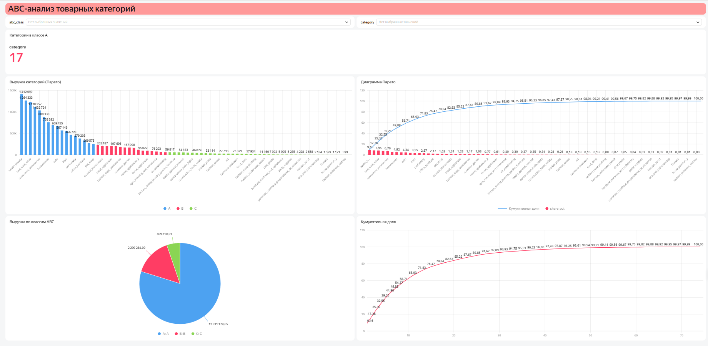

# ЛР-3. Аналитический дашборд для бизнес-кейса — вариант 3

**Студент:** Шведова С.С. · **группа:** БД-251м
**Бизнес-кейс:** ABC-анализ товарных категорий

## Цель работы
Какие категории приносят 80 % выручки (класс A), какие — следующие 15 % (B) и какие можно не развивать (C)?

## Исследуемые метрики
- **Число категорий** = `COUNTD([category])`

## Архитектура решения
Kaggle (Olist, 9 CSV) → Python (`urllib`, `pandas`) → SQLite: RAW → STAGING → CORE → витрина `dm_v03_abc_categories` → CSV → Yandex DataLens.

## Технологический стек
Python 3.13.18, pandas 2.2.3, SQLite 3.45.1, Google Colab / Jupyter, Yandex DataLens.

## Схема данных
Слои: `raw_*` (9 таблиц) → `stg_*` (типизация, очистка) → `core_order`, `core_item`, `dim_state` → `dm_v03_abc_categories` (VIEW).
<!-- вставьте скриншот или ER-диаграмму: img/er.png -->

## SQL витрины
```sql
CREATE VIEW dm_v03_abc_categories AS
WITH cat AS (
  SELECT category,
         SUM(item_value)              AS revenue,
         COUNT(*)                     AS items
  FROM core_item
  WHERE order_status = 'delivered'
  GROUP BY category
),
ranked AS (
  SELECT category, revenue, items,
         ROW_NUMBER() OVER (ORDER BY revenue DESC, category) AS rank_num,
         ROUND(revenue * 100.0 / SUM(revenue) OVER (), 4)    AS share_pct,
         ROUND(SUM(revenue * 100.0) OVER (ORDER BY revenue DESC, category)
               / SUM(revenue) OVER (), 4)                    AS cum_share_pct
  FROM cat
)
SELECT category,
       ROUND(revenue, 2) AS revenue,
       items,
       rank_num,
       share_pct,
       cum_share_pct,
       CASE
         WHEN cum_share_pct <= 80 THEN 'A'
         WHEN cum_share_pct <= 95 THEN 'B'
         ELSE 'C'
       END AS abc_class
FROM ranked
```

## Контрольные значения
| Вопрос | Ответ |
|---|---|
| Число категорий класса A | 17 |
| Доля выручки класса A, % | 79.8 |

## Дашборд DataLens
Ссылка: https://datalens.yandex/dp9fbbecta2sw

| № | Тип | Название |
|---|---|---|
| 1 | Индикатор | Категорий в классе A |
| 2 | Столбчатая диаграмма | Выручка категорий (Парето) |
| 3 | Круговая диаграмма | Выручка по классам ABC |
| 4 | Линейная диаграмма | Кумулятивная доля |
| 5 | Комбинированная диаграмма | Диаграмма Парето |



## Выводы и бизнес-рекомендации
1. **Концентрация выручки (Класс А):** На основе данных дашборда, 17 категорий класса А приносят суммарно **12 311 179,65 R$**. Это подтверждает закон Парето: около 80% всей выручки компании генерируется ограниченным числом ключевых категорий (лидеры — *health_beauty*, *bed_bath_table*, *computers_accessories*).
2. **Средний и длинный хвост (Классы B и C):** Класс B объединяет 15 категорий с общей выручкой **2 299 284,09 R$** (следующие ~15% дохода). Оставшийся длинный хвост (класс C) — это 42 категории, которые в сумме дают лишь около 5% выручки (менее 809 310 R$).
3. **Рекомендация для бизнеса:** Следует сфокусировать маркетинговый бюджет и логистические ресурсы на удержании и развитии категорий класса А (особенно *health_beauty* и *bed_bath_table*). Категории класса C нужно перевести в режим экономии: не тратить на них рекламный бюджет, оптимизировать складские запасы или вовсе выводить из ассортимента, если они убыточны.
